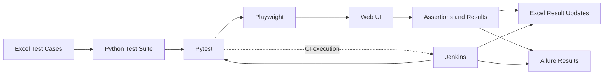

<div align="center">

<!-- Replace this banner with a real project screenshot or diagram if desired. -->
# Playwright Automation

### Excel-Driven UI Test Automation 路 Broadcast Platform

**Reliable regression testing with Python, Playwright, Pytest, Jenkins, Excel & Allure**

<p>
  <a href="https://www.python.org/"></a>
  <a href="https://playwright.dev/python/"></a>
  <a href="https://pytest.org/"></a>
  <a href="https://www.jenkins.io/"></a>
  <a href="https://allurereport.org/"></a>
  <a href="https://github.com/iamgstomar/Playwright-Automation"></a>
</p>

[Overview](#-overview) 路 [Features](#-highlights) 路 [Quick Start](#-quick-start) 路 [Run Tests](#-run-tests) 路 [Jenkins](#-jenkins-cicd)

</div>

---

## 鈿?Overview

**Playwright Automation** is a Python-based UI testing framework for the **Puffin Broadcast Platform**. It combines browser automation with Excel-based test-case management and CI execution to make regression testing repeatable, traceable, and easier to maintain.

The workbook `QA_Test_Cases.xlsx` is the central test-case inventory. Pytest runs the implemented test functions, Playwright drives the browser, and the project's reporting utilities update Excel and prepare Allure results.

> **Design principle:** Keep test cases traceable, browser checks repeatable, and reports aligned with the tests that actually ran.

## 鉁?Highlights

<table>
<tr>
<td width="50%" valign="top">

### 馃И Browser automation
- Python + Playwright
- Pytest test discovery and assertions
- Shared fixtures and login helpers
- Run one test, one module, or a full suite

</td>
<td width="50%" valign="top">

### 馃搳 Excel-based test management
- `QA_Test_Cases.xlsx` as the test inventory
- Module-specific worksheets
- Execution status and actual-result updates
- Summary generation through project utilities

</td>
</tr>
<tr>
<td width="50%" valign="top">

### 馃殌 CI/CD with Jenkins
- Windows-based pipeline execution
- Dependency and browser setup
- Parameterized test selection when configured
- Build status and post-test stages

</td>
<td width="50%" valign="top">

### 馃搱 Reporting and diagnostics
- Allure result generation
- PASS / FAIL / BLOCKED / SKIPPED tracking
- Configurable test timeouts and reruns
- Login diagnostics and configured failure screenshots

</td>
</tr>
</table>

## 馃攧 How it works



1. **Select** a test case, module, or full suite.
2. **Execute** browser steps through Playwright.
3. **Validate** the actual UI behavior using assertions.
4. **Record** execution results through the project's Excel reporting utilities.
5. **Review** the pytest output, Excel summary, and Allure report data.

## 馃О Technology stack

| Technology | Role |
|---|---|
| [Python](https://www.python.org/) | Test logic, helpers, configuration and utilities |
| [Playwright](https://playwright.dev/python/) | Browser automation |
| [Pytest](https://pytest.org/) | Test runner, fixtures, markers and assertions |
| [pytest-rerunfailures](https://github.com/pytest-dev/pytest-rerunfailures) | Configurable reruns for eligible failures |
| [pytest-timeout](https://github.com/pytest-dev/pytest-timeout) | Timeout protection |
| [Allure Pytest](https://allurereport.org/docs/pytest/) | Test result output for Allure |
| Excel (`.xlsx`) | Test inventory and result tracking |
| [Jenkins](https://www.jenkins.io/) | CI/CD orchestration |

---

## 馃Л Test coverage

The current framework is organized into these application modules:

| Module | Focus |
|---|---|
| Departments | Department UI and form workflows |
| SMS Broadcast | SMS campaign workflows |
| Push Broadcast | Push campaign workflows |
| Inbox Broadcast | Inbox campaign workflows |
| MessageTemplate | Message-template workflows |
| User Management | User and access-management workflows |
| CreditReports | Credit report workflows |
| Reports | Reporting pages and filters |
| Credit Management | Credit and balance workflows |
| Home-Header | Home page and header elements |
| Login | Login and authentication workflows |
| General-CrossCutting | Shared and cross-module behavior |

The number of tests and their statuses can change between runs. Check the current workbook and Pytest collection output for the latest counts.

## 馃梻锔?Repository map

```text
Playwright-Automation/
鈹溾攢鈹€ config/
鈹?  鈹斺攢鈹€ config.yaml                 # Environment configuration
鈹溾攢鈹€ tests/
鈹?  鈹溾攢鈹€ conftest.py                 # Shared fixtures and browser/login helpers
鈹?  鈹溾攢鈹€ test_Departments.py         # Department tests
鈹?  鈹斺攢鈹€ test_*.py                   # Other module suites
鈹溾攢鈹€ tools/
鈹?  鈹溾攢鈹€ generate_tests_from_excel.py
鈹?  鈹溾攢鈹€ excel_to_allure.py          # Workbook results to Allure data
鈹?  鈹斺攢鈹€ ...                         # Supporting tools
鈹溾攢鈹€ utils/
鈹?  鈹斺攢鈹€ excel_writer.py             # Excel result updates
鈹溾攢鈹€ QA_Test_Cases.xlsx              # Central test-case workbook
鈹溾攢鈹€ pytest.ini                      # Pytest options and markers
鈹溾攢鈹€ requirements.txt                # Python dependencies
鈹溾攢鈹€ Jenkinsfile                     # CI/CD pipeline
鈹斺攢鈹€ README.md
```

This is a guide to the principal paths discussed in the project. Check the current repository if files have been moved or renamed.

---

## 馃殌 Quick start

### 1. Prerequisites

- Python version supported by the project's dependencies
- Git
- Network access to the chosen test environment
- Approved QA/UAT test credentials
- Playwright browser binaries
- Jenkins and Allure CLI only if you need those workflows

Check your tools:

```powershell
python --version
git --version
```

### 2. Clone the repository

```powershell
git clone https://github.com/iamgstomar/Playwright-Automation.git
cd Playwright-Automation
```

### 3. Create and activate a virtual environment

Windows PowerShell:

```powershell
python -m venv .venv
.\.venv\Scripts\Activate.ps1
```

If activation is restricted, call the environment's Python executable directly:

```powershell
.\.venv\Scripts\python.exe -m pip install --upgrade pip
```

> **Environment note:** The Jenkins workspace may use `venv` rather than `.venv`. Use the environment name configured in your machine or pipeline.

### 4. Install dependencies

```powershell
python -m pip install --upgrade pip
python -m pip install -r requirements.txt
```

If the project uses additional plugins, ensure they are declared in `requirements.txt` so a fresh environment can be recreated consistently.

### 5. Install Chromium

Run this using the same Python environment that will run Pytest:

```powershell
python -m playwright install chromium
python -m playwright install --list
```

### 6. Configure the test target

Update the project's configuration file using the existing schema. Confirm the target URL and approved test credentials before running tests.

**Do not commit real passwords, tokens, or private configuration to Git.**

### 7. Run one test

```powershell
python -m pytest -v -s tests/test_Departments.py::test_TC_DIC_001_add_department_form_fields_displayed
```

A successful run should show the test as `PASSED` and a passing pytest summary.

---

## 鈻讹笍 Run tests

Execute these commands from the repository root with the intended Python environment active.

<details>
<summary><strong>Run the full test suite</strong></summary>

```powershell
python -m pytest -v -s
```

</details>

<details>
<summary><strong>Run one module file</strong></summary>

```powershell
python -m pytest -v -s tests/test_Departments.py
```

</details>

<details>
<summary><strong>Run a single test case</strong></summary>

```powershell
python -m pytest -v -s tests/test_Departments.py::test_TC_DIC_001_add_department_form_fields_displayed
```

</details>

<details>
<summary><strong>Run by pytest marker</strong></summary>

```powershell
python -m pytest -v -s -m departments
python -m pytest -v -s -m login
python -m pytest -v -s -m sms_broadcast
python -m pytest -v -s -m push_broadcast
python -m pytest -v -s -m inbox_broadcast
```

Use marker names defined in `pytest.ini`; the examples above assume those markers exist in your current checkout.

</details>

<details>
<summary><strong>Filter tests by name</strong></summary>

```powershell
python -m pytest -v -s -k "department"
```

</details>

<details>
<summary><strong>Override the timeout for diagnosis</strong></summary>

```powershell
python -m pytest -v -s --timeout=180 tests/test_Departments.py
```

A longer timeout can help diagnose slow CI agents, but investigate any test that hangs instead of relying on longer timeouts as the permanent solution.

</details>

### Common Pytest options

| Option | Description |
|---|---|
| `-v` | Show individual test names and results |
| `-s` | Display printed diagnostics |
| `-m marker` | Select tests by marker |
| `-k "text"` | Select tests by name expression |
| `--timeout=180` | Override the configured timeout |
| `--alluredir=allure-results` | Write Allure result files |

## 馃摌 Excel test-case management

`QA_Test_Cases.xlsx` is the central test-case inventory. It includes a summary/index and module-specific worksheets.

### Result tracking

The reporting workflow supports result categories such as:

- **PASS** 鈥?the test passed.
- **FAIL** 鈥?the test failed.
- **BLOCKED** 鈥?execution could not proceed.
- **SKIPPED** 鈥?the test was intentionally not run.

Depending on the test and reporting path, the workbook can also capture **Actual Result**, **Tested By**, and **Date Tested**.

### Add or update a test case

1. Add or update the case in the correct worksheet.
2. Keep the existing test ID convention.
3. Implement or update the matching Python test.
4. Apply the appropriate Pytest marker.
5. Run the test and verify its assertion.
6. Confirm that the result writer maps the test to the correct workbook row.
7. Verify the Excel summary and reporting output.

Example test naming convention:

```python
def test_TC_DIC_001_add_department_form_fields_displayed():
    ...
```

The test ID should map consistently to the corresponding workbook ID (for example, `TC_DIC_001` to `TC-DIC-001`) according to the project's mapping logic.

> **Keep Excel and code synchronized.** The workbook documents test cases and expected results; Python implements the executable checks. Never treat an unexecuted test as PASS.

## 馃彈锔?Jenkins CI/CD

The repository's `Jenkinsfile` orchestrates automation execution and reporting in the configured Jenkins environment.

### Typical pipeline lifecycle

1. **Checkout** the source revision.
2. **Prepare** Python, dependencies, configuration, and QA files.
3. **Install browser binaries** compatible with the installed Playwright package.
4. **Run selected tests** using Pytest.
5. **Update Excel and prepare Allure results.**
6. **Generate or publish reports** when configured.
7. **Run post-build actions**, such as artifact handling and email notifications.

### Example Windows commands

Use the same virtual environment for dependency installation, browser setup, and test execution:

```bat
venv\Scripts\python.exe -m pip install -r requirements.txt
venv\Scripts\python.exe -m playwright install chromium
venv\Scripts\python.exe -m pytest -v -s
```

Integrate these commands into the existing pipeline; do not remove established credential handling, configuration setup, or reporting stages.

### Parameterized builds

If the Jenkins job defines a `TEST_MODULE` choice parameter, it can be connected to the corresponding Pytest markers:

```bat
if "%TEST_MODULE%"=="all" (
    venv\Scripts\python.exe -m pytest -v -s
) else (
    venv\Scripts\python.exe -m pytest -v -s -m %TEST_MODULE%
)
```

This example assumes the parameter exists and its values match markers in `pytest.ini`. Parameters such as `TARGET_ENV` or `BROWSER` only affect execution if the pipeline and test configuration explicitly consume them.

### When a test times out in Jenkins

- Run the failing test alone first.
- Review the login and navigation debug output.
- Check URL reachability from the Jenkins agent.
- Verify that the Jenkins service account can access the required browser binaries.
- Confirm that Jenkins uses the intended virtual environment.
- Investigate the operation that is hanging before permanently increasing timeouts.

**Reporting integrity:** preserve the Pytest exit code and use results from the current run. An interrupted test, missing result, or timeout must not be reported as PASS merely because an older Excel value remains.

## 馃搱 Allure reports

### Create Allure result files

```powershell
python -m pytest -v -s tests/test_Departments.py --alluredir=allure-results
```

### Generate an HTML report

With the Allure CLI installed:

```powershell
allure generate allure-results --clean -o allure-report
```

### Open the report

```powershell
allure open allure-report
```

If the project bundles Allure in a local directory, use the CLI path configured in your project or Jenkins pipeline.

### Excel-to-Allure conversion

The repository includes `tools/excel_to_allure.py` for processing workbook results into Allure data. The current pipeline has used a command in this form:

```bat
venv\Scripts\python.exe tools\excel_to_allure.py --all --label ""
```

Confirm the arguments supported by your checked-out script. After a timeout or interrupted run, compare the converter's output with the actual Pytest summary.

---

## 馃Н Troubleshooting

<details>
<summary><strong>Chromium executable is missing</strong></summary>

Install the browser using the same Python environment as Pytest:

```powershell
python -m playwright install chromium
python -m playwright install --list
```

</details>

<details>
<summary><strong>Pytest does not recognize <code>--reruns</code></strong></summary>

Install the rerun plugin in the active environment:

```powershell
python -m pip install pytest-rerunfailures
```

</details>

<details>
<summary><strong>Pytest reports an unknown <code>timeout</code> option</strong></summary>

Install the timeout plugin:

```powershell
python -m pip install pytest-timeout
python -m pytest --help
```

</details>

<details>
<summary><strong>Allure import or decorator error</strong></summary>

Check the installed plugin and imported module:

```powershell
python -m pip show allure-pytest
python -c "import allure; print(allure.__file__); print(hasattr(allure, 'epic'))"
```

Make sure Python is importing the intended Allure module.

</details>

<details>
<summary><strong>Login or navigation times out</strong></summary>

Check the configured URL, network reachability, login diagnostics, browser startup, and the exact operation where execution stops. Test the same case in isolation before running the full suite.

</details>

<details>
<summary><strong>Excel reports PASS after a timeout</strong></summary>

Inspect the result-mapping and summary-generation utilities. Ensure that stale workbook values and tests without a result from the current run are not counted as PASS.

</details>

<details>
<summary><strong>Jenkins email is not sent</strong></summary>

Review the email extension configuration and confirm that valid recipients are configured for the job or pipeline.

</details>

### Environment diagnostic commands

```powershell
python --version
python -m pytest --version
python -m pip show playwright
python -m pip show pytest-rerunfailures
python -m pip show pytest-timeout
python -m pip show allure-pytest
python -m playwright install --list
```

Run diagnostics in the same environment that produced the failure.

---

## 馃攼 Security and quality guidelines

- Use approved QA/UAT accounts and controlled test data.
- Store secrets in Jenkins Credentials or an approved secret manager.
- Never commit passwords, tokens, private keys, or sensitive configuration.
- Avoid logging credentials or exposing sensitive data in screenshots and reports.
- Keep test IDs consistent across Excel and Python.
- Use stable locators and meaningful assertions.
- Use retries to help diagnose intermittent behavior, not to hide defects.
- Keep BLOCKED, SKIPPED, failed, and unexecuted cases distinct.
- Validate reports against the actual Pytest output.
- Keep dependencies and browser versions reproducible across developer and CI machines.

## 馃椇锔?Roadmap

Possible future improvements鈥攏ot claims of existing functionality鈥攊nclude:

- Test execution trends and historical reporting.
- Stronger consistency checks between Pytest, Excel, and Allure.
- Pre-run environment validation.
- Clearer failure diagnostics for browser startup and navigation.
- Broader regression coverage across application modules.
- More robust CI artifact retention and notification handling.

## 馃 Contributing

1. Follow the existing naming and marker conventions.
2. Update the corresponding Excel test case.
3. Run the affected test locally.
4. Validate the result mapping and reports.
5. Review the changes before committing.

Example commit messages:

```text
test: add department validation coverage
fix: improve login wait handling
docs: refresh automation README
ci: align Playwright browser installation
```

---

<div align="center">

### Built for repeatable QA and dependable regression feedback.

**[猸?Explore the repository](https://github.com/iamgstomar/Playwright-Automation)**

<sub>Excel-driven test management 路 Browser automation 路 CI execution 路 Reporting</sub>

</div>
